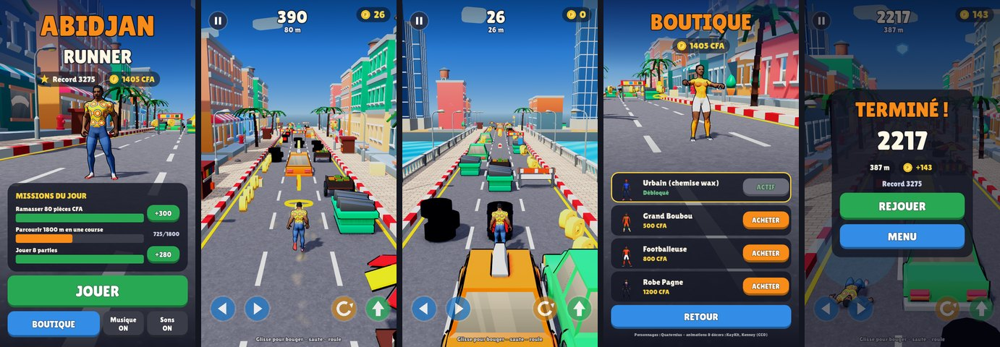
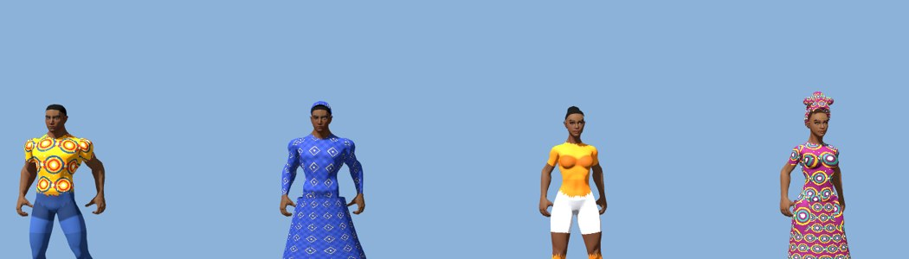

# 🏃🏾 ABIDJAN RUNNER

Un **endless runner 3D** inspiré d'Abidjan : cours dans le Plateau, esquive les taxis
*wôrô-wôrô*, saute les nids-de-poule, roule sous les banderoles et ramasse des pièces
CFA, de l'alloco, du coco et de l'akpakpa. Vitesse progressive, score, meilleur score
sauvegardé, missions quotidiennes et 4 skins à débloquer.

Moteur : **Godot 4.4** (GDScript, renderer GL Compatibility, optimisé mobile 60 FPS).
Les visuels combinent des **assets libres** — coureurs réalistes basés sur les Universal Base
Characters de Quaternius (CC0), habillés en **tenues africaines** (chemise wax, grand boubou en
bazin brodé + kufi, maillot des Éléphants, robe pagne + gele) et animés avec des clips KayKit
retargetés ; rue KayKit, pièces/nuages/sons Kenney (CC0), police Lilita One — et des assets
**générés par script** pour tout ce qui est propre à Abidjan (voir [CREDITS.md](CREDITS.md)).





---

## 🎮 Gameplay

- **3 couloirs** (gauche / centre / droite)
- **Sauter** par-dessus les obstacles bas (barrière, nid-de-poule, pneu, cône, fût)
- **Rouler** sous les obstacles hauts (banderole / barre de toit)
- **Changer de voie** pour éviter les blocs (taxi compteur orange, wôrô-wôrô vert,
  benne à ordures, pousse-pousse de bananes plantain, stand de garba à parasol)
- **Power-ups** : 🧲 aimant à objets · 🛡️ bouclier (encaisse un choc) · ✖️2 multiplicateur
- **Collectibles** : pièces CFA (monnaie), coco, alloco, akpakpa, smartphone (bonus)
- **Vitesse** qui augmente avec la distance
- **Génération procédurale infinie** par chunks recyclés + **pooling** des obstacles (zéro
  instanciation en cours de partie → pas de lag)
- **Missions quotidiennes** (pièces / distance / parties) avec récompenses
- **Boutique** : 4 personnages (2 garçons, 2 filles) — Urbain en chemise wax, Grand Boubou,
  Footballeuse, Robe Pagne
- **Menu / Pause / Game Over**, UI tactile mobile + support clavier
- **Deux ambiances** : les rues colorées de la ville (palmiers, lampadaires, bordures
  peintes rouge/blanc) et la **traversée du pont sur la lagune Ébrié**, avec les tours
  du Plateau de l'autre côté de l'eau
- **Effets** : poussière de course, bouffée à l'atterrissage, étincelles sur les pièces,
  bulle de bouclier, halos lumineux sous les power-ups, nuages, eau animée (shader)

### Contrôles

| Action        | Clavier                | Tactile                    |
|---------------|------------------------|----------------------------|
| Gauche/Droite | ← → ou A / D           | Swipe horizontal / boutons |
| Sauter        | ↑ / W / Espace         | Swipe haut / bouton        |
| Rouler        | ↓ / S                  | Swipe bas / bouton         |
| Pause         | Échap                  | Bouton pause               |

---

## ⬇️ Télécharger

Builds prêtes à l'emploi dans [`dist/`](dist/) :

| Plateforme | Fichier | Remarque |
|---|---|---|
| Android | `AbidjanRunner.apk` | signée (debug), installation directe |
| Windows | `AbidjanRunner-windows.zip` | dézipper, lancer `AbidjanRunner.exe` |
| Linux | `AbidjanRunner-linux.zip` | dézipper, `./AbidjanRunner.x86_64` |

## ▶️ Lancer le jeu

1. Installer **Godot 4.4.x** (branche standard, GDScript) : <https://godotengine.org/download>
2. Ouvrir le projet : `Godot → Import → sélectionner project.godot`
3. Appuyer sur **F5** (ou le bouton ▶). Godot ré-importe les assets au premier lancement.

En ligne de commande :

```bash
godot --path . scenes/Main.tscn
```

---

## 📁 Structure

```
game1/
├── project.godot            # config moteur, autoloads, input map
├── export_presets.cfg       # presets Windows / Linux / Android
├── icon.png
├── scenes/
│   └── Main.tscn            # scène principale (bootstrap)
├── scripts/
│   ├── global.gd           # autoload: sauvegarde, pièces, record, skins, missions
│   ├── audio.gd            # autoload: SFX + musique
│   ├── data.gd             # constantes & tables (obstacles, collectibles, skins…)
│   ├── main.gd             # orchestrateur (états, routing signaux)
│   ├── game.gd             # monde 3D, caméra, score, power-ups
│   ├── player.gd           # CharacterBody3D: voies, saut, roulade, hitbox
│   ├── chunk_manager.gd    # génération procédurale, biomes ville/lagune, pooling
│   ├── spawnable.gd        # obstacle / collectible / power-up poolé
│   ├── mats.gd             # matériaux partagés (asphalte, pavés, latérite, eau)
│   └── ui.gd               # menus, HUD, pause, game over, boutique
├── assets/
│   ├── thirdparty/         # packs CC0 téléchargés (KayKit, Kenney) + licences
│   ├── models/             # .glb générés (route, tours, palmiers, obstacles, objets)
│   ├── textures/           # asphalte, pavés, latérite, sprites de particules
│   ├── shaders/            # eau de la lagune
│   ├── fonts/              # Lilita One (OFL)
│   ├── ui/                 # icônes + portraits des skins
│   └── audio/              # SFX (Kenney + générés), musique, ambiance
└── tools/                  # générateurs Python + outils de capture/test (non exportés)
```

---

## 🛠️ Régénérer les assets (optionnel)

Les assets sont déjà commités. Pour les régénérer :

```bash
pip install pillow numpy
cd tools
python3 gen_env.py          # route, tours du Plateau, palmiers, kiosque, garde-corps du pont
python3 gen_items.py        # obstacles, collectibles, power-ups
python3 gen_surfaces.py     # textures asphalte / pavés / latérite + sprites de particules
python3 gen_textures.py     # icône appli + icônes UI
python3 gen_audio.py        # SFX + musique
./build_runners.sh          # coureurs Quaternius : tenues africaines, coiffes, animations + glissade
python3 recolor_atlas.py    # taxi orange / wôrô-wôrô vert (atlas KayKit City)
python3 prune_gltf.py IN.glb OUT.glb --keep Idle,Running_A --drop Cape  # allège un .glb
```

Le pipeline écrit directement des `.glb` glTF 2.0 via `tools/gltf_builder.py`, **sans
Blender** : une seule surface par modèle (couleurs par sommet) pour limiter les draw
calls. `gen_characters.py` (ancien personnage procédural riggé) est conservé mais n'est
plus utilisé.

### Captures et tests (développement)

```bash
tools/shots/run.sh /tmp/shots                                   # captures (Xvfb + Mesa)
godot --headless --path . --fixed-fps 60 res://tools/shots/soak.tscn   # 2 min de jeu, fuites
```

---

## 📦 Export (Windows / Linux / Android)

Le script `tools/build.sh` gère l'export. Il faut les *export templates* Godot 4.4.1
(installés automatiquement par le script s'ils manquent).

```bash
# Windows .exe + Linux binaire
tools/build.sh windows
tools/build.sh linux

# APK Android (nécessite le SDK Android + JDK 17 — voir plus bas)
tools/build.sh android
```

Ou directement :

```bash
godot --headless --path . --export-release "Windows Desktop" builds/windows/AbidjanRunner.exe
godot --headless --path . --export-release "Linux"          builds/linux/AbidjanRunner.x86_64
godot --headless --path . --export-release "Android"        builds/android/AbidjanRunner.apk
```

### Prérequis Android (APK)

1. **JDK 17** (`apt install openjdk-17-jdk`)
2. **Android SDK** (cmdline-tools) avec `platform-tools`, `build-tools;34.0.0`,
   `platforms;android-34`
3. Dans Godot : *Editor → Editor Settings → Export → Android* → renseigner le chemin du
   SDK et de la debug keystore (Godot peut générer une debug keystore :
   `keytool -keyalg RSA -genkeypair -alias androiddebugkey -keypass android -keystore debug.keystore -storepass android -dname "CN=Android Debug,O=Android,C=US" -validity 9999`)
4. `tools/build.sh android` exporte alors `builds/android/AbidjanRunner.apk`.

> En mode headless/CI, renseigner les chemins via
> `~/.config/godot/editor_settings-4.4.tres` (clés `export/android/android_sdk_path` et
> `export/android/debug_keystore`).

#### Astuce : sans le SDK Google (Debian/Ubuntu)

Si `dl.google.com` est bloqué, les seuls outils requis pour signer une APK
(`apksigner`, `zipalign`, `adb`) s'installent via apt, puis on fabrique une
arborescence SDK minimale :

```bash
sudo apt-get install -y apksigner zipalign adb openjdk-17-jdk
SDK=$HOME/android-sdk
mkdir -p "$SDK/platform-tools" "$SDK/build-tools/34.0.0"
ln -sf "$(which adb)"       "$SDK/platform-tools/adb"
ln -sf "$(which apksigner)" "$SDK/build-tools/34.0.0/apksigner"
ln -sf "$(which zipalign)"  "$SDK/build-tools/34.0.0/zipalign"
keytool -keyalg RSA -genkeypair -alias androiddebugkey -keypass android \
  -keystore "$HOME/debug.keystore" -storepass android \
  -dname "CN=Android Debug,O=Android,C=US" -validity 9999
# Dans ~/.config/godot/editor_settings-4.4.tres :
#   export/android/android_sdk_path = "<...>/android-sdk"
#   export/android/debug_keystore   = "<...>/debug.keystore"
godot --headless --path . --export-debug "Android" builds/android/AbidjanRunner.apk
```

> C'est exactement la méthode utilisée pour produire l'APK signé
> (`apksigner verify` → schémas v1 + v2 + v3 ✅).

---

## ⚙️ Détails techniques

- **CharacterBody3D** joueur, détection par `Area3D` (hitbox qui monte au saut / descend
  à la roulade) → l'esquive dépend réellement de la pose.
- **Chunks** de 12 m recyclés (9 actifs) : quand un chunk passe derrière le joueur, il est
  repositionné devant, re-décoré et repeuplé. Obstacles, objets **et décor** sont
  **poolés** ; les pools sont pré-remplis à la demande maximale mesurée (test de 2 min :
  nombre de nœuds stable, 0 nœud orphelin).
- **~350 draw calls** par image en course (ombres limitées aux objets proches, modèles
  générés à surface unique, matériaux partagés ; contours toon sur obstacles et coureur).
- **Rendu** : tonemapping Filmic + contraste/saturation, lumière ambiante en partie neutre
  (pas de dominante bleue), MSAA 4x, filtrage anisotrope, ombres 2 cascades (4096 px,
  2048 sur mobile), contours « inverted hull » et ombres de contact sous les obstacles.
- **Coureurs** : squelette humain de 65 os (Quaternius) ; tenues peintes dans la texture à partir
  d'une carte « position 3D par pixel » (coupes nettes), relief musculaire aplati sous les
  vêtements, coiffes moulées sur le crâne ; animations KayKit retargetées + glissade créée à la
  main + mains en poing souple.
- **Difficulté** progressive (nombre de voies bloquées / rangées) — au moins une voie
  toujours franchissable.
- **Brouillard de profondeur** (55 → 125 m) : masque l'apparition des chunks lointains
  sans délaver le premier plan.
- Sauvegarde locale JSON dans `user://abidjan_runner_save.json`.

---

## 📜 Licence / crédits

Assets tiers : KayKit (Kay Lousberg) et Kenney en **CC0**, police Lilita One en **OFL** —
détail complet dans [CREDITS.md](CREDITS.md). Le reste (code, assets générés, musique)
a été créé pour ce projet. Style cartoon low-poly, thème Abidjan 🇨🇮.
